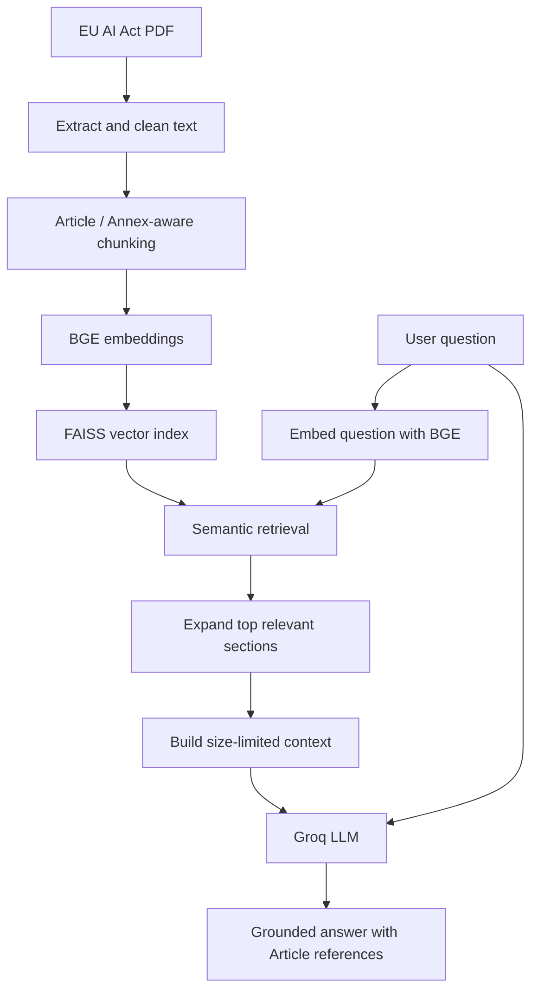

# EU AI Act RAG Assistant

A Python-based **Retrieval-Augmented Generation (RAG)** assistant that answers questions using relevant provisions from the **EU AI Act**. The project combines document processing, semantic search, and grounded language-model generation.

> **Scope:** Educational and portfolio project. Answers are based on the indexed document and are **not legal advice**. Consult the official legislation for authoritative information.

## What the project does

- Extracts and cleans text from a consolidated EU AI Act PDF.
- Organizes the document into **Article- and Annex-aware chunks**.
- Converts chunks into vector embeddings and searches them with **FAISS**.
- Compares two sentence-embedding models: **MiniLM** and **BGE**.
- Expands relevant sections so that longer Articles are not represented by only one fragment.
- Limits context size to fit the available LLM API budget.
- Uses a Groq-hosted language model to generate answers grounded in retrieved text.
- Evaluates whether expected Articles appear in the context and generated answers.

## Architecture



The pipeline uses **`BAAI/bge-small-en-v1.5`** for retrieval and **`openai/gpt-oss-20b`** through the Groq API for answer generation.

## Dataset and processing

**Source:** Consolidated EU AI Act, Regulation (EU) 2024/1689, EUR-Lex consolidation dated **27 July 2026**.

- [EUR-Lex consolidated text](https://eur-lex.europa.eu/eli/reg/2024/1689/2026-07-27)
- [Source PDF](https://eur-lex.europa.eu/legal-content/EN/TXT/PDF/?uri=CELEX%3A02024R1689-20260727)

The preprocessing pipeline extracts text, cleans formatting artifacts, identifies Articles and Annexes, and splits long sections into overlapping chunks while retaining section metadata. The resulting dataset contains **160 chunks**. The consolidated document and the model output should not be treated as a substitute for checking the official legal text.

## Repository structure

```text
eu_ai_act_rag/
├── data/
│   ├── raw/                         # EU AI Act PDF
│   └── processed/                   # Text, chunks, embeddings, FAISS indexes
├── evaluation/
│   ├── retrieval_questions.json     # Curated 12-question test set
│   ├── minilm_retrieval_results.md
│   ├── bge_retrieval_results.md
│   └── model_comparison.md
├── src/
│   ├── text_extraction.py
│   ├── text_cleaning.py
│   ├── text_chunking.py
│   ├── create_embeddings.py         # MiniLM
│   ├── create_faiss_index.py        # MiniLM
│   ├── create_bge_embeddings.py
│   ├── create_bge_faiss_index.py
│   ├── test_retrieval.py
│   ├── test_bge_retrieval.py
│   └── rag_pipeline.py
├── .gitignore
├── requirements.txt
└── README.md
```

Additional development and test scripts may be present in `src/`.

## Setup

**Recommended:** Python 3.9 with a virtual environment. Run the following commands from the project root.

```bash
python3 -m venv .venv
source .venv/bin/activate       # macOS / Linux
python -m pip install -r requirements.txt
```

Create a `.env` file in the project root:

```dotenv
GROQ_API_KEY=your_groq_api_key_here
```

**Never commit `.env` or your real API key.** The project uses `python-dotenv` to load this variable.

## Run the assistant

The repository includes processed chunks and indexes, so you can run the main pipeline directly after installing dependencies and configuring your API key:

```bash
python src/rag_pipeline.py
```

Choose one of the menu options:

```text
1 - Ask a question
2 - Run RAG evaluation
```

Example question:

> What transparency obligations apply to AI systems that interact with people or generate synthetic content?

The program displays retrieved chunks, expanded sections, and a generated answer referencing relevant Articles. Actual answers depend on the model and retrieved context.

### Rebuild the data pipeline (optional)

The processing and indexing scripts are included for inspection and reproducibility. They are designed to be run from the repository root:

```bash
python src/text_extraction.py
python src/text_cleaning.py
python src/text_chunking.py
python src/create_bge_embeddings.py
python src/create_bge_faiss_index.py
```

The repository also contains the corresponding MiniLM embedding and indexing scripts for comparison.

## Evaluation

### Embedding model comparison

A curated set of **12 questions** with expected Article references was used to assess whether the relevant Article appeared in the top retrieval results.

| Embedding model | Hit@1 | Hit@3 | Hit@5 |
|---|---:|---:|---:|
| MiniLM (`all-MiniLM-L6-v2`) | 75.0% | 75.0% | 83.3% |
| BGE (`bge-small-en-v1.5`) | 75.0% | 100.0% | 100.0% |

BGE was selected for the main RAG pipeline based on its performance on **this small, curated test set**. These numbers are not estimates of performance across all possible EU AI Act questions.

### End-to-end RAG checks

The evaluation mode also checks two narrower properties:

| Check | Observed result |
|---|---:|
| Expected Article present in expanded LLM context | 12/12 (100%) |
| Expected Article mentioned in generated answer | 12/12 (100%) |

**Important limitation:** These results came from a resumed evaluation: the first nine answers were saved before the final context-length limit was introduced, and the last three were generated with the new limit. They therefore **do not represent a single controlled run under identical settings**. The checks measure Article coverage and mention, **not factual correctness, legal completeness, or hallucination rate**. A consistent rerun and manual answer-quality review are needed for stronger conclusions.

## Engineering decisions

- **Section-aware chunking:** Keeps Article/Annex labels attached to the text, making results interpretable.
- **Section expansion:** Includes additional chunks from the top three relevant sections, helping with Articles that span multiple chunks.
- **Context-size control:** Caps the text passed to the LLM to avoid oversized requests; this can omit some details from long sections.
- **API resilience:** Retries temporary connection and rate-limit errors and saves evaluation progress so completed questions need not be repeated after an interruption.
- **Grounding:** Instructs the model to answer only from retrieved context, reference the relevant provisions, and acknowledge missing information.

## Limitations and future work

- The test set contains only 12 curated questions; broader testing is needed.
- Article mentions do not establish answer faithfulness or legal accuracy.
- The context cap may truncate relevant passages.
- The document is a dated consolidation; legislative updates require refreshing the source and rebuilding the index.
- Potential improvements include token-aware context budgeting, reranking, answer-faithfulness assessment, citation validation, and a lightweight web interface.

## Technology stack

**Python · PyMuPDF · Sentence Transformers · BGE · MiniLM · NumPy · FAISS · Groq API · python-dotenv**
